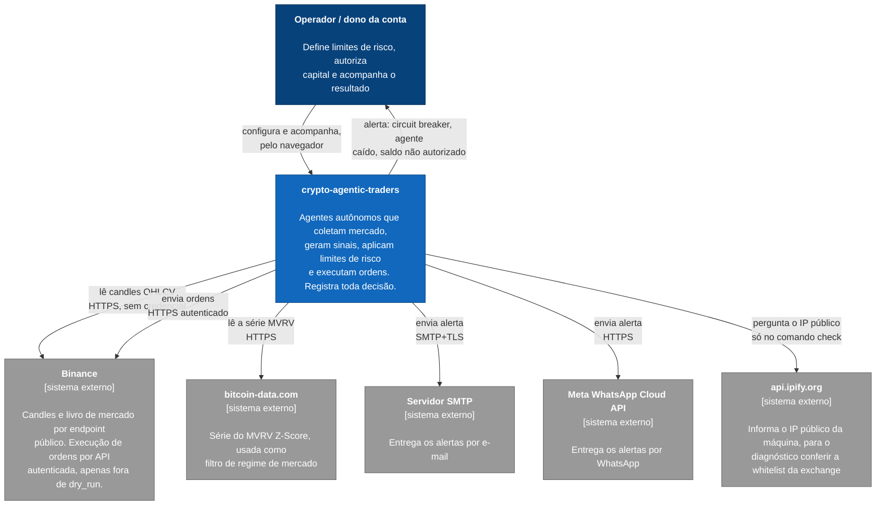
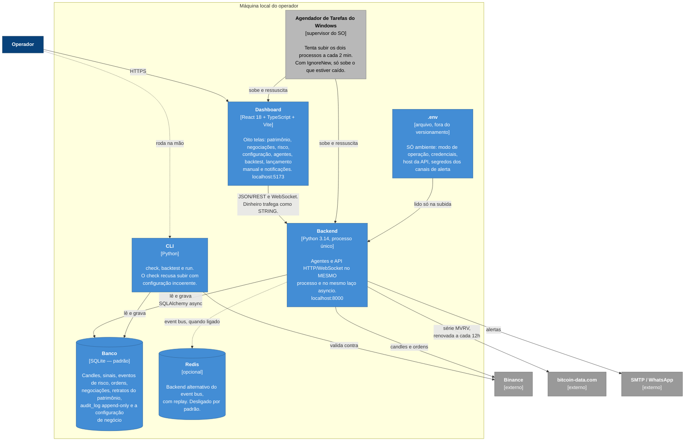
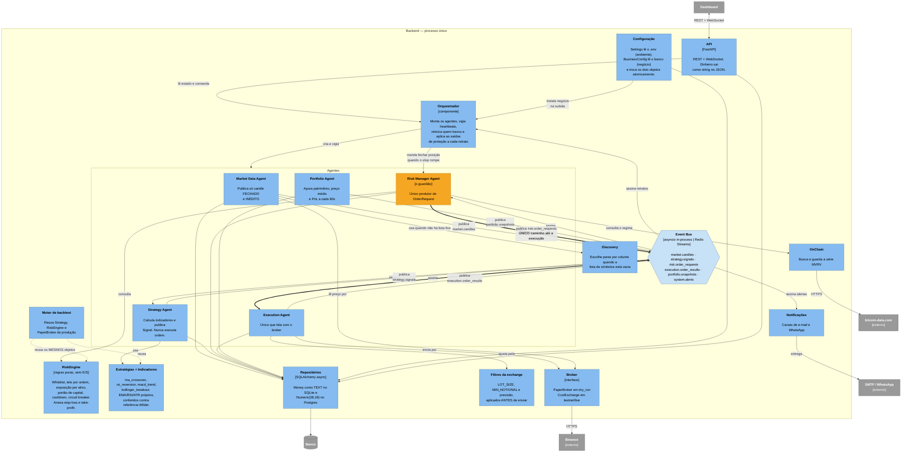
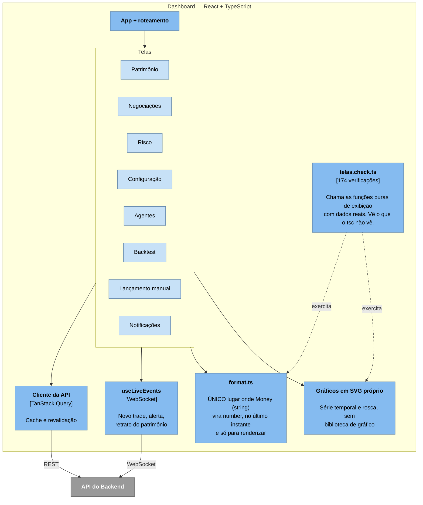

# Diagramas C4 — crypto-agentic-traders

Os três primeiros níveis do [C4 Model](https://c4model.com): contexto, contêineres
e componentes. Em Mermaid, que o GitHub renderiza direto neste arquivo.

Este documento descreve o sistema que **existe**, não o que se pretendia construir.
Onde há diferença entre o plano original e o código, a diferença está anotada — é a
mesma regra de [ARQUITETURA.md](ARQUITETURA.md) e [SEGURANCA.md](SEGURANCA.md), e
existe porque neste projeto documentação errada sobre proteção já custou dias:
lia-se "stop-loss configurado" enquanto o stop não executava.

**Para quem está lendo pela primeira vez:** comece pelo Nível 1, leia as três
invariantes logo abaixo e depois desça. As invariantes são o que os diagramas
existem para tornar visível.

---

## As três invariantes estruturais

O desenho todo serve para garantir estas três coisas. Se um diagrama abaixo
parecer contradizer alguma delas, o diagrama está errado e deve ser corrigido.

| # | Invariante | Onde aparece |
|---|---|---|
| 1 | **Nenhuma ordem chega ao Execution Agent sem passar pelo Risk Manager.** Não existe atalho: o Strategy Agent publica `Signal`, nunca `OrderRequest`. | Nível 3, seta única `risk.order_requests` |
| 2 | **O Market Data Agent não tem credencial.** Dado de mercado é público; o agente que coleta não precisa de poder de gastar, então não o recebe. | Nível 3, `MarketDataSource` sem credencial |
| 3 | **Ligar dinheiro real exige editar arquivo no servidor e reiniciar.** `TRADING_MODE` e `LIVE_TRADING_CONFIRMED` são ambiente, nunca banco — um clique na interface não pode ligar ordem real. | Nível 2, seta `.env` → Backend |

---

## Nível 1 — System Context

Quem usa, e com quem o sistema fala.

**A assimetria que vale notar:** o sistema fala com a Binance por dois caminhos
distintos. O de leitura é público e sempre ativo. O de escrita é autenticado e
**só existe fora de `dry_run`** — em simulação o broker nem chega a ser
construído com credencial.

---

## Nível 2 — Container

O que roda onde. "Contêiner" aqui é no sentido do C4 — uma coisa executável ou
armazenável separadamente —, não Docker.

### Por que um processo só

Agentes e API compartilham processo e laço `asyncio` por decisão explícita
([D5](../README.md#decisões)). Um agendador externo — Celery, APScheduler —
acrescentaria infraestrutura sem ganho para uma máquina só. O custo dessa escolha
é real e está aceito: **uma falha não contida derruba tudo junto**, e é por isso
que o watchdog e a supervisão do SO existem.

### Por que o `.env` é lido só na subida

A fronteira ambiente/negócio ([D15](SEGURANCA.md)) é a regra mais rígida de
configuração do projeto. O `.env` descreve a instalação; tudo que responde
*"o que eu quero negociar e com quanto risco"* mora no **banco** e é editado pela
interface. Escrever variável de negócio no `.env` faz o sistema **recusar subir**,
listando as chaves — porque um valor que parece ter efeito e não tem é pior que
valor nenhum. Foi assim que este `.env` pediu ordem máxima de 7 durante dias
enquanto o sistema operava com 50.

---

## Nível 3 — Component: dentro do Backend

O contêiner que concentra as decisões sobre dinheiro.

### O caminho da ordem, em uma frase

`Market Data` publica candle fechado → `Strategy` publica `Signal` → `Risk Manager`
aprova ou rejeita e, se aprova, publica `OrderRequest` já com stop e alvo anexados →
`Execution` envia. **As setas grossas no diagrama são esse caminho.** Não existe
outra aresta chegando ao `Execution Agent`, e é isso que torna "totalmente autônomo"
compatível com "sob controle".

### Três detalhes que o diagrama esconde

**O stop-loss é software, e roda no orquestrador.** A cada retrato do patrimônio o
orquestrador chama `enforce_protective_exits` no Risk Manager, que compara o preço
com o nível calculado a partir do preço médio. Não há ordem OCO parada na exchange:
se o processo estiver fora do ar, a posição fica sem saída automática. A seção 12 do
[SEGURANCA.md](SEGURANCA.md) lista exatamente o que esse stop **não** cobre.

**O circuit breaker bloqueia abrir, nunca fechar.** A assimetria é deliberada
(D4) e já foi violada uma vez: `pause_all` pausava o Execution Agent, e como é
`pause_all` que a trava chama, a venda de proteção ficava órfã na fila justamente
quando o mercado caía. Hoje a pausa atinge `strategy` e `risk_manager`; a execução
continua viva para conseguir fechar.

**O backtest reusa os objetos de produção, e isso não bastou.** A intenção de
[D3](ARQUITETURA.md) é que testar o backtest seja testar o código real. Ainda
assim, **quatro divergências** entre os dois caminhos já foram encontradas e
corrigidas — a última em setembro de 2026, quando um par de cotação antiga
sobrescrevia a chave de preço e o backtest respondia "esta estratégia não opera"
sobre uma estratégia que opera. Reuso de código reduz a divergência; não a elimina.

---

## Nível 3 (complemento) — Component: dentro do Dashboard

**Por que `format.ts` merece uma caixa própria.** Dinheiro trafega como *string*
do banco até a tela ([D7](SEGURANCA.md)), porque `number` em JavaScript é ponto
flutuante de dupla precisão e perderia centavos em valores grandes. A conversão
acontece num único lugar e no último instante possível. Ter um só ponto de
conversão é o que torna a regra verificável em vez de aspiracional.

**Por que existe um harness fora do `tsc`.** Os defeitos de tela deste projeto
passaram todos pelo compilador sem uma reclamação: eixo com oito rótulos idênticos,
eixo Y colapsando três marcações em "29", a tela anunciando USDT depois da migração
para USDC, e todo o texto secundário abaixo de WCAG AA. Tipo certo, tela errada. O
harness chama as funções puras de exibição com os dados reais medidos no sistema, e
cada bloco tem par: *o defeito existe* e *o conserto age*.

---

## O que estes diagramas não mostram

Honestidade sobre os limites, pela mesma razão da seção 17 do
[SEGURANCA.md](SEGURANCA.md) — um diagrama que sugere mais solidez do que a
medição sustenta é pior que diagrama nenhum.

- **Postgres e TimescaleDB aparecem como opção e nunca foram exercitados em
  servidor.** O adapter existe e o schema é o mesmo, mas os seis testes que
  provariam a ida e volta no dialeto de produção estão `skipped` por falta de
  servidor nesta máquina.
- **Redis aparece como alternativa do event bus e roda desligado.** O contrato é
  único e a troca é uma linha no `.env`, mas o caminho ativo hoje é o `asyncio`
  in-process.
- **O caminho de escrita na Binance nunca foi exercitado com dinheiro real nem
  contra testnet.** O sistema roda em `dry_run`, com `PaperBroker`.
- **A supervisão do SO cobre o logon do operador, não a máquina sem ninguém
  conectado.** Rodar sem usuário conectado exigiria guardar a senha no Agendador —
  uma decisão que cabe ao dono da conta, não à automação.
